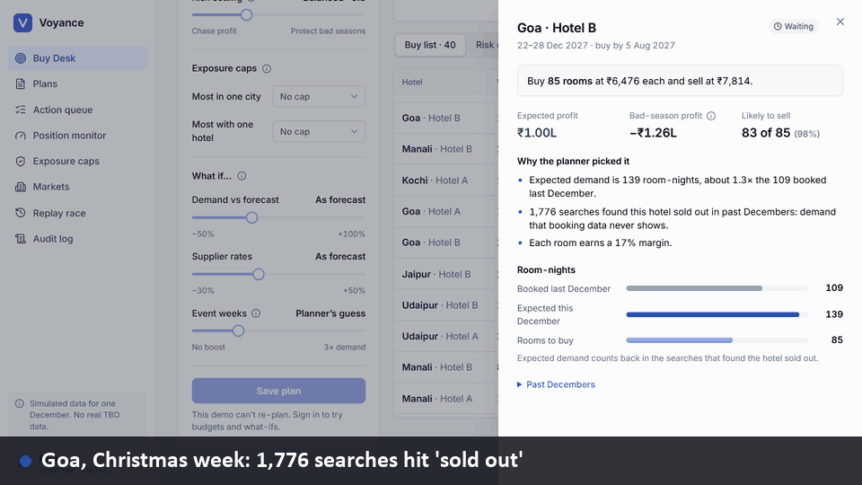
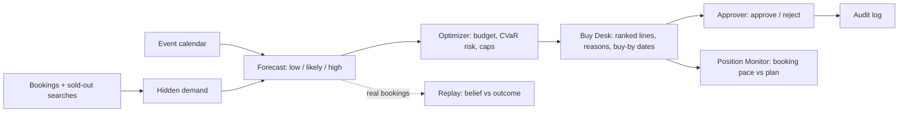

<div align="center">

# Voyance

**Sees hotel demand before it sells out.**
A pre-buy planner for a travel distributor's hotel buyers: give it a budget and a risk level, and it returns
a ranked list of rooms to buy ahead, each with a reason, a buy-by date and its worst case, for a second person
to approve.

*Voyance doesn't blindly automate procurement. It gives buyers an explainable, risk-aware decision, lets them
approve it, and then proves whether that decision was actually better.*

Built for **TBO VoyageHack 4.0**, Problem 1: Inventory Optimization

[**Live demo**](https://voyance-1029341879804.asia-south1.run.app) · [API docs](https://voyance-1029341879804.asia-south1.run.app/docs) · [Team plan](PLAN.md)

`Python 3.11+` · `FastAPI` · `HiGHS (LP)` · `LightGBM + SHAP` · `React + TypeScript` · `246 tests`

</div>

> The Buy Desk runs on **simulated** data (TBO's data isn't plugged in yet). Every claim below says whether it
> comes from the simulation or from **real hotel bookings**, and the real-data results are walk-forward: each
> decision uses only what was known on its day.



*The live Buy Desk, one story: Goa in Christmas week. 1,776 searches hit "sold out" in past Decembers, so it
buys 85 rooms by 5 Aug, and a second person approves the line. Simulated data.*


## The problem, and what's new

Distributors pre-buy hotel rooms ahead of peak dates, sized from booking history. But a search that hits
"sold out" never becomes a booking, so the busiest dates look smaller than they were: buyers under-buy the peaks
and overspend on quiet weeks.

| | What Voyance does |
|---|---|
| **Hidden demand** | Counts sold-out searches back in, the way airlines correct for sold-out flights |
| **Event signals** | Separates festival, match and concert weeks, so last year's spike isn't mistaken for a trend |
| **Budget as a portfolio** | One optimizer weighs expected profit against the worst 5% of seasons (CVaR), within the budget and any city or hotel caps |
| **Every line explained** | Each buy says why, in numbers; each skipped hotel-week says what the money earns elsewhere |
| **Cancellations** | Plans count only on bookings that stay: early cancellations are demand that never comes, late ones leave a room empty (both measured on real agent bookings) |
| **Human in the loop** | A second person approves every line; nothing is a buy until it is approved; everything is in an audit log |

## Results at a glance

**On real hotel bookings** (119,390 bookings at two hotels in Portugal, 2015-2017; outcomes count only bookings that stayed, since 41% of agent bookings cancel; tested on Jan-Aug 2017, walk-forward; 95% intervals resample whole months, so neighbouring weeks can't make them look tighter than they are):

| | Re-buy last year | Voyance |
|---|---|---|
| Forecast error, 90-150 days ahead | 15.5% | **9.5-10.7%** |
| Profit from buying by the forecast | baseline | **+7% to +13%**, every 95% interval above zero |
| Room-nights turned away | baseline | **35-46% fewer** |
| Replay, 68 hotel-weeks (120 days ahead, 20% margin) | €1,160,430 | **€1,272,142** (+10%) |
| **The planner itself** (exploratory: risk 0.3; forecast range recalibrated walk-forward; weeks correlated within a month, as measured on 2016) | baseline | **+6% to +20%** at every lead (90-150 days) and margin (15-30%), every 95% interval above zero |

The range had to be recalibrated first. As forecast, its 80% range caught the actual 72-79% of the time and the
planner at risk 0.3 lost in 5 of 9 cases; rescaled month by month on finished weeks only, it catches 69-81% and
wins in all 9. That rescaling was added after the plain planner won only 4 of 9, so it is exploratory until it
is tested on new data. It earns about what buying the forecast earns (-0.4% to +6.2%) with 3-15% less money
committed. We also tried the classic hotel **pickup** forecast (bookings on the books + last year's pickup)
as a stronger baseline: here it did 12-61% *worse* than re-buying, because 2017's early bookings ran far ahead
of what stayed, so re-buying stays the bar. Everything, including a plain newsvendor (`optimizer_risk_0`), is in
`out/decision_backtest.json`.

**In simulation** (500 simulated Decembers, 40 hotel-weeks in 5 Indian cities, against re-buying past bookings):

| Budget | Expected profit | Worst 5% of seasons | Worlds where Voyance earns more |
|---|---|---|---|
| ₹40L | **+24.0%** [23.7, 24.4] | +4.9% | 100% |
| ₹60L | **+13.7%** [13.4, 14.0] | −1.5% | 100% |
| ₹1.2 cr | about even | −2.5% | 51% |
| ₹2 cr | **+3.9%** [3.5, 4.2] | **+20.4%** [19.0, 21.7] | 84% |

**When Voyance matters most:** when money is short it chooses where to cut (+24% at ₹40L); when money is ample
it chooses where to add and protects the bad season (+20% at ₹2 cr, spending ₹1.32 cr where re-buying spends
₹1.48 cr). Around ₹1.2 cr neither lever bites: that is about what re-buying last year costs anyway, so trimming
its list evenly is nearly optimal.

**Hidden demand on real demand** (semi-real, `scripts/censoring_test.py`, `out/censoring_test.json`): the public
dataset has no sold-out searches, so we kept the real demand and censored it. With last year's allotment set at
each hotel's typical week, 41 of 68 real hotel-weeks sold out and bookings missed 11% of demand; sold-out searches
were drawn from the demand that didn't fit. Counting them back in recovers last year's demand to within 0.1%, and
sized the planner's way it earns **+12% to +14%** more than the same sizing on bookings (+9% to +16% with the
look-to-book ratio 30% off or half the searches duplicated). With an allotment 20% bigger, only 2% of demand was
hidden and the gain is +1-2%. Re-buying a whole estimate is the wrong rule at these margins: it over-buys, even
knowing last year's demand exactly. In the full simulation, the stress test (`scripts/stress_test.py`,
`out/stress_test.json`) breaks the planner's assumptions on purpose. Half the
searches missing or noisy logs leave Voyance ahead; **over-counting hurts**: with 50% duplicate searches (agents
retrying), a look-to-book ratio 30% too low or no event lift, it over-buys and does 7-10% worse than re-buying
at ₹2 cr. So searches must be de-duplicated before use (see How TBO's data plugs in).

**With cancellations** (41% of real agent bookings cancel, 11.5% of those in the last week, too late to resell;
same 500 worlds, every strategy knows the rate, `out/proof_study_cancellations.json`): everyone earns much less,
and Voyance still earns more at every budget: **+19.3%** at ₹40L, +3.9% at ₹60L, +2.0% at ₹80L, and from ₹1 cr
up **+8.5%** profit with a **+58% better bad season** (94% of worlds). Plans count on the bookings that stay by
default.


The simulator's December shape was set by hand on 4 Nov and checked against the real bookings two weeks later
(`out/calibration.json`): the Christmas-week peak matches (1.45× the December average vs our 1.47×; only 4
hotel-years of Decembers, so a sanity check, not proof), and real demand swings less from year to year (about 22%) than we
simulate (35%), so the simulation is the harder test.

## How it works



The language model never decides anything: it only writes briefs from numbers the planner produced, and every
figure it cites is checked against the plan.

## Features

| Feature | What a buyer gets |
|---|---|
| **Buy plan** | Hotel, week, rooms, buy-by date, expected profit, this line's own bad-season profit and the chance every room sells, ranked |
| **Why / why not** | The numbers behind each buy, and why not one more room ("would sell only 82% of the time, making about ₹734: not enough for the bad-season risk it adds"); for each hotel-week skipped, "a room here makes ₹1,128; the same ₹8,883 makes ₹2,092 in the rest of the plan" |
| **Hurdle rate** | What every rupee must earn to get into the plan, straight from the optimizer's shadow prices |
| **Risk curve** | Profit and bad-season profit at every risk setting: "at 0.3 you give up ₹24,643 to make ₹1.45L more in a bad season" |
| **What-ifs** | Demand, supplier rates and event strength: the same optimizer re-plans, nothing is saved |
| **Exposure caps** | No city or hotel above a share of the budget, with what the caps cost |
| **Action queue** | Buy now (due within 14 days), scheduled, watch, skip, with a reason each |
| **Position Monitor** | After buying: each line's bookings against the real December pace, projected demand and the gap. Flags only |
| **Replay** | Real 2017 weeks: what the forecast believed and why, what each buyer bought, what happened |
| **Selling price** | Each line's recommended price, never below cost: the rate moved by how busy the week is for its hotel. On real bookings a week 10% busier than the hotel's typical week sold about 7% higher; a busier *year* for the same week barely moved agent rates (slope 0.05), so the price follows the week, not the year |
| **Buyer briefs** | A local model on the GPU writes a plain-English brief; numbers it didn't get from the plan are rejected |
| **Approvals and audit** | Four-eyes approval on every line, nobody approves their own plan, every action logged |

## Quick start

Needs Python 3.11+ (and Node 22+ for the dashboard).

```bash
python -m pip install -e ".[test]"
python -m pytest                              # 246 tests, about a minute

python scripts/seed_demo.py                   # demo companies and API keys (printed once)
uvicorn voyance.api.app:create_app --factory  # API at http://127.0.0.1:8000/docs

cd web && npm install && npm run dev          # dashboard at http://localhost:5173
```

Sign in with a key from `seed_demo.py`, or build the dashboard with
`VITE_DEMO_KEYS='{"asha":"vy_…","ravi":"vy_…",…}'` for one-click "Try it as" buttons. Demo people: **asha**
(buyer), **ravi** (approver), **meera** (admin) at "TBO Demo", and **zed** (admin) at "Other Distributor", who
can't see TBO Demo's plans. For fixed keys across re-seeds, set `VOYANCE_DEMO_KEY_ASHA` (and `_RAVI`, `_MEERA`,
`_ZED`). The hosted demo is one container (`Dockerfile`, `deploy/cloudrun.sh`).

## The evidence, reproducible

| Command | What it shows |
|---|---|
| `python scripts/proof_chart.py` | The Round 1 chart, 20 simulated worlds (`out/proof_chart.png`, `out/proof_results.csv`) |
| `python scripts/proof_study.py 500` | The same on 500 worlds across every CPU core, with 95% intervals (`out/proof_study.json`); add `0.41` for the run with cancellations |
| `python scripts/calibrate.py` | The simulator against the real bookings; downloads 16 MB once (`out/calibration.json`) |
| `python scripts/censoring_test.py` | Hidden demand on real demand: an allotment hides last year's peaks, synthetic sold-out searches bring them back (`out/censoring_test.json`) |
| `python scripts/forecast_backtest.py` | Forecast and buying decisions on real 2017 bookings, and the replay (`out/*_backtest.json`) |
| `VOYANCE_API_KEY=vy_… python scripts/brief.py 1` | A buyer brief from a local model on the GPU (PyTorch with CUDA and `transformers`); without them, or with `--template`, a fixed-form brief from the same checked facts |

## API

Send the key in the `X-API-Key` header. Full contract at `/docs`.

| Endpoint | Who | What |
|---|---|---|
| `GET /v1/me` | anyone | Your name, role and company |
| `GET /v1/markets` | anyone | Hotel-weeks that can be bought, with past bookings and sold-out searches |
| `POST /v1/plans` | anyone | Budget + risk (+ cities, caps) in; ranked buy plan out, with hurdle rate, exposure and every hotel-week passed |
| `POST /v1/plans/preview` | anyone | The same without saving, with what-ifs (`demand_change`, `cost_change`, `event_lift`, `cancel_rate`); 120 a minute |
| `GET /v1/frontier` | anyone | Profit and worst case at risk 0, 0.1 … 1 for one budget; 10 a minute |
| `GET /v1/plans`, `/v1/plans/{id}` | anyone | Your company's plans |
| `GET /v1/plans/{id}/queue?as_of=` | anyone | The action queue for a day |
| `GET /v1/plans/{id}/position?as_of=` | anyone | The Position Monitor for a day |
| `GET /v1/replay` | anyone | Real 2017 bookings, week by week |
| `PATCH /v1/plans/{id}/lines/{line}` | approver, admin | Approve or reject a line; never your own plan |
| `GET /v1/plans/{id}/export.csv` | anyone | The plan as a spreadsheet |
| `GET /v1/audit` | admin | Who did what |

Settings: `VOYANCE_DATABASE_URL` (default `sqlite:///voyance.db`; any SQLAlchemy URL) and
`VOYANCE_CORS_ORIGINS` (exact dashboard origins; `*` is refused). There are no database migrations yet: after a
schema change, delete `voyance.db` and seed again.

## Security model

- Keys belong to a person at a company; only SHA-256 hashes are stored, and keys can be revoked.
- A company never sees another company's plans, lines or audit log (it gets 404).
- Nobody approves their own plan, even with a second key; a decision is final, and two approvers clicking at
  once can't both win.
- 30 plans a minute per person (429 after that), at most 4 plans in the planner at once (503 if busy); the
  hosted demo adds a per-network limit in front, since its demo keys are public.
- Every solve runs on one long-lived thread: SciPy's HiGHS crashed the process when a thread that had solved
  exited, which a web server's worker threads do all the time.
- Keys travel in a header, so run it behind HTTPS outside a laptop demo.

## What we tried and dropped

Being clear about what didn't work is part of the evidence:

- **Autopilot** (top up or release rooms automatically as bookings arrive): +22% in simulation, but **−4% to
  −8%** on real 2017 bookings, because early booking pace is too noisy to trade on. It became the Position
  Monitor: flags, with the buyer deciding.
- **A pretrained forecaster** (Amazon Chronos-Bolt, run on the GPU): worse than re-buying last year on its own
  (20-23% error) and no help as an extra input. What's already booked beats any amount of history.
- **Conformal recalibration of the forecast's range:** unstable on two hotels' history. A simpler walk-forward
  monthly rescaling replaced it, and it is what makes the planner win on real data.

## How TBO's data plugs in

The planner reads its world through one interface (`voyance/api/datasource.py`); today it serves the
simulation, and a TBO adapter replaces it. What each feed is for:

| TBO feed | What Voyance needs from it | Where it goes |
|---|---|---|
| Hotel searches with an availability flag | Searches that found nothing left, per hotel and stay week, **de-duplicated per agent, hotel and date** (retries and bots inflate them: see the stress test) | Hidden demand (`voyance/demand.py`) and the look-to-book ratio |
| Bookings with booked-on and cancelled-on dates | Room-nights per hotel and arrival week, by lead time | The forecast's booking curves (`voyance/forecast.py`), the cancellation rates, the Position Monitor |
| Contract rates and allotments | Cost per room-night, allotment size, release dates | The planner's costs and hotel limits (`/v1/markets`) |
| Selling rates | What TBO sells each hotel-week at | The planner's prices and the recommended selling price |
| Event calendar | Event weeks per city | The event lift (`data/events/events.csv` is the first sourced calendar) |

The first pilot step is logging sold-out searches if TBO doesn't already (`docs/business_case.md`).

## Project layout

| Path | What it does |
|---|---|
| `voyance/demand.py` | Hidden demand (bookings + sold-out searches ÷ searches per booking) and demand scenarios |
| `voyance/optimizer.py` | The budget + CVaR linear program (HiGHS), with shadow prices and group caps |
| `voyance/sim.py` | Simulated Decembers, booking pace and the strategies compared |
| `voyance/calibrate.py` | Facts measured on real bookings: December shape, year-to-year swing, buy-ahead days, booking pace |
| `voyance/forecast.py` | Booking-curve forecast: LightGBM low / likely / high with SHAP reasons, walk-forward |
| `voyance/backtest.py`, `voyance/replay.py` | Buying strategies scored on real outcomes; the week-by-week replay |
| `voyance/brief.py` | Facts for a buyer brief, and the check that a model invented no numbers |
| `voyance/api/` | The Buy Desk API: planner, position monitor, storage, auth, approvals, audit log |
| `web/`, `e2e/` | The React dashboard and its end-to-end tests |
| `deploy/`, `Dockerfile` | The hosted demo on Cloud Run |
| `scripts/` | Seeding, the proof chart and study, calibration, backtests, briefs |
| `PLAN.md` | Team plan, timeline and decisions |

## Data credit

The "Hotel booking demand" dataset: N. Antonio, A. de Almeida, L. Nunes (2019), *Data in Brief* 22: 41-49,
licence CC BY 4.0. `scripts/calibrate.py` downloads it, checks it by SHA-256 and keeps it out of this repo.
